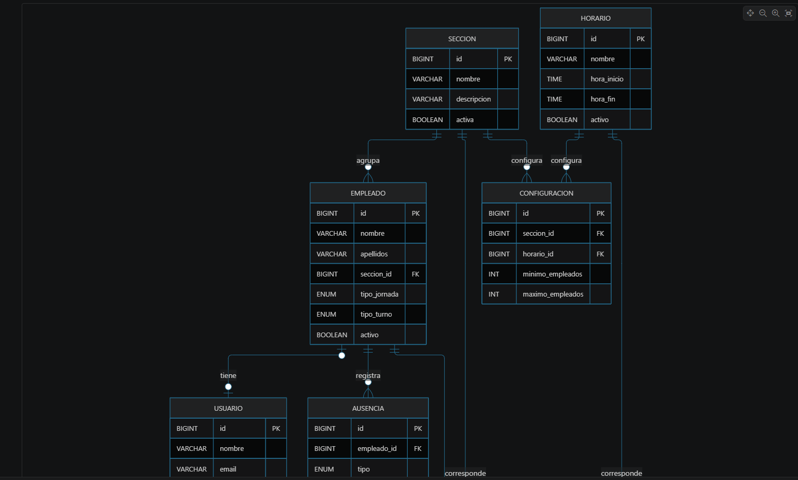
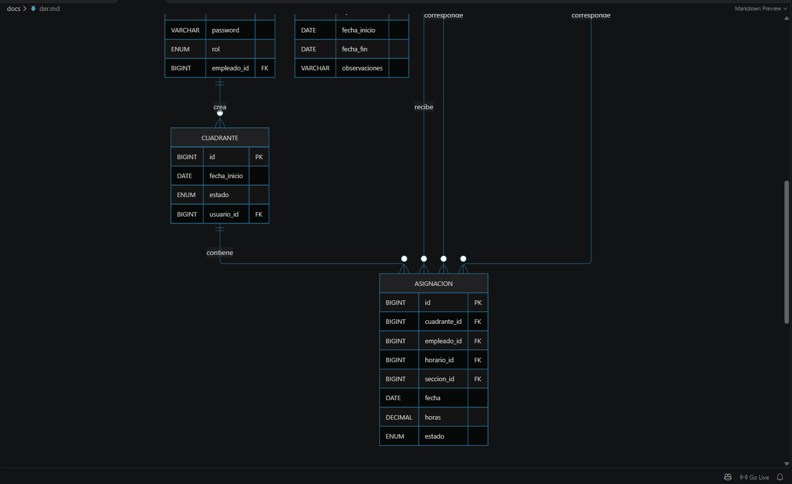

<div style="text-align: center;">

## CENTRO INTEGRADO DE FORMACIÓN PROFESIONAL AVILÉS

**FAMILIA PROFESIONAL DE INFORMÁTICA Y COMUNICACIONES**

Ciclo Formativo de Grado Superior en Desarrollo de Aplicaciones Web

Modalidad Virtual · Curso 2026/2027

Proyecto Intermodular (0379 · PIDW2)

# GESTIONATURNOS

**Aplicación web para la gestión de turnos de supermercado**

# Hito 2: Modelo de datos, API REST y autenticación segura

</div>

---

**Alumna:** Eva Rodríguez Pérez

**Profesor tutor:** Pablo Lera Menéndez

**Repositorio GitHub:** [github.com](https://github.com/Eva1394/daw-proyecto-gestionaturnos)

**Tag de entrega:** hito-2 / v0.2.0

**Fecha:** 20/11/2026

<div style="page-break-before: always;"></div>

## Índice

1. Introducción
2. Modelo relacional
3. Catálogo de endpoints
4. Seguridad y control de acceso
5. Evidencias de ejecución
6. Código clave
7. Arquitectura en capas

<div style="page-break-before: always;"></div>

## 1. Introducción

GestionaTurnos es una aplicación web para organizar los turnos de trabajo en supermercados. Este segundo hito continúa el anteproyecto del Hito 1 y desarrolla el backend completo: un modelo relacional en tercera forma normal, una API REST en capas y un sistema de autenticación con control de acceso por roles.

La API está desarrollada con **Laravel** y **MySQL**. La autenticación usa **Laravel Sanctum** con tokens de acceso personal, y el esquema de permisos se apoya en dos roles: **administrador**, que corresponde a las encargadas y gestiona toda la información, y **empleado**, que solo puede consultar sus propios turnos.

<div style="page-break-before: always;"></div>

## 2. Modelo relacional

### 2.1 Diagrama entidad-relación





### 2.2 Justificación de la tercera forma normal

**Primera forma normal (1FN).** Todos los atributos son atómicos. No hay listas ni campos multivaluados: un empleado tiene una sola sección habitual y una sola jornada, y los turnos no se guardan como texto dentro del empleado, sino como filas de **asignaciones**.

**Segunda forma normal (2FN).** Todas las tablas usan una clave primaria simple (**id**), así que ningún atributo depende de una parte de la clave. No existen dependencias parciales.

**Tercera forma normal (3FN).** No hay dependencias transitivas entre campos no clave. El nombre y la descripción de una sección no se repiten en **empleados**: solo se guarda **seccion_id**. Lo mismo ocurre con **horarios**: **asignaciones** no repite las horas de inicio y fin, solo guarda **horario_id**.

**Relaciones y cardinalidades.** La relación **1:N** aparece entre **secciones** y **empleados**: una sección agrupa a varios empleados, y cada empleado pertenece a una sola sección. La relación **M:N** entre **empleados** y **horarios** se resuelve con la tabla intermedia **asignaciones**, que además aporta atributos propios de la relación: **fecha**, **horas** y **estado**. La relación M:N entre **secciones** y **horarios** se resuelve con **configuraciones**, que aporta **minimo_empleados** y **maximo_empleados**.

### 2.3 Diccionario de datos resumido

[Pega aquí la tabla de `docs/diccionario_datos.md`]

<div style="page-break-before: always;"></div>

## 3. Catálogo de endpoints

Todas las rutas llevan el prefijo **/api** Las que están bajo autenticación requieren la cabecera **Authorization: Bearer <token>**.

| Método | Ruta | Acceso | Respuesta correcta |
|---|---|---|---|
| POST | /login | Público | 200 con el token |
| GET | /perfil | Autenticado | 200 |
| POST | /logout | Autenticado | 200 |
| GET | /mis-asignaciones | Empleado | 200 |
| GET | /secciones, /horarios | Admin | 200 |
| GET | /empleados, /configuraciones, /ausencias, /cuadrantes, /asignaciones | Admin | 200 |
| GET | /{recurso}/{id} | Admin | 200 |
| POST | /{recurso} | Admin | 201 |
| PUT o PATCH | /{recurso}/{id} | Admin | 200 |
| DELETE | /{recurso}/{id} | Admin | 204 |

Los recursos con CRUD completo son **secciones**, **empleados**, **horarios**, **configuraciones**, **ausencias**, **cuadrantes** y **asignaciones**.

**Códigos de error.** 401 sin token válido, 403 con un rol no autorizado, 404 si el recurso no existe, 422 con datos inválidos y 500 ante un error del servidor.

**Formato de error.** Todas las respuestas de error siguen la especificación RFC 9457 (Problem Details):

```json
{
  "type": "about:blank",
  "title": "Error de validación",
  "status": 422,
  "detail": "Los datos enviados no son válidos.",
  "instance": "/api/secciones",
  "errors": [...]
}

## 4. Seguridad y control de acceso

**Hasheo de contraseñas.** Las contraseñas se almacenan con **bcrypt**, aplicado automáticamente por el cast **password** => **hashed** del modelo **User**. El factor de coste es 12, superior al mínimo de 10 exigido. El atributo **password** está declarado en **$hidden**, de modo que el hash nunca aparece en ninguna respuesta JSON.

**Emisión de sesiones.** El inicio de sesión emite un **token de acceso personal de Sanctum** con una expiración de 2 horas, que el cliente envía en la cabecera **Authorization: Bearer <token>**. El cierre de sesión revoca el token activo.

**Middlewares de control.** Todas las rutas salvo **/login** están protegidas por el middleware **auth:sanctum**, que devuelve **401** si el token falta o no es válido. El middleware **ComprobarRol** restringe los endpoints de administración y devuelve **403** si el rol no está autorizado. Ambos errores siguen el formato RFC 9457.

**Resource Ownership (anti-BOLA).** Las consultas a datos de otros empleados están reservadas al rol administrador. El empleado solo puede acceder a sus propios turnos mediante el endpoint **/mis-asignaciones**, que filtra por la identidad del usuario autenticado.

**Gestión de secretos.** Las variables sensibles residen en el archivo **.env**, incluido en **.gitignore**. El archivo `.env.example` está versionado con valores ficticios.

<div style="page-break-before: always;"></div>

## 5. Evidencias de ejecución

### 5.1 Regeneración de la persistencia

La base de datos se reconstruye por completo desde código con un único comando:

```bash
php artisan migrate:fresh --seed

## 5.2 Pruebas de la API
Inicio de sesión correcto (200): 
(img/Postman_200.png)

Creación de un recurso (201):
(img/Postman_201.png)

Petición sin token (401):
(img/Postman_401.png)

Petición con rol no autorizado (403):
(img/Postman_403.png)

Datos inválidos (422):
(img/Postman_422.png)

Recurso no encontrado (404):
(img/Postman_404.png)